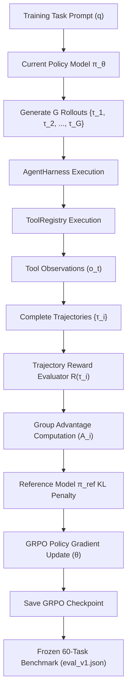

# Architecture Design Record: 009_grpo_architecture

- **Document ID:** `009_grpo_architecture`
- **Date:** 2026-08-28
- **Target Model:** `Qwen/Qwen3-1.7B` (Full-Parameter GRPO / RL)
- **Starting Checkpoint Candidate:** `outputs/qwen3-1.7b-tool-agent-sft-v4-500` (SFT V4)
- **Status:** Architectural Specification & Design (NO TRAINING EXECUTED)

---

## 1. Motivation

Supervised Fine-Tuning (SFT) optimizes the maximum likelihood of teacher trajectories:
$$\mathcal{L}_{\text{SFT}}(\theta) = -\sum_{t} \log \pi_\theta(a_t | s_t)$$

While SFT V4 successfully taught the model syntax formatting (88.9% valid tool call rate), tool selection (100% accuracy), and multi-step continuation (70.8% accuracy), it induced a severe **tool over-activation bias**: the model invoked tools on 75.0% of direct knowledge (`no_tool`) queries, regressing `no_tool` accuracy to 33.3%. System prompt ablation (Experiment 008) further proved that inference-time prompting cannot fix this bias and causes a 25.0% performance collapse when overloaded with verbose rules.

To solve this policy breakdown, we shift from SFT to **Group Relative Policy Optimization (GRPO)**. Trajectory-level Reinforcement Learning optimizes the policy directly against environment feedback and reward signals, rewarding the model for **using tools only when necessary** and **answering directly when sufficient internal knowledge exists**.

---

## 2. Evidence from Previous Experiments

| Experiment | Model State | System Prompt Protocol | Overall Acc | No-Tool Acc | Tool Sel Acc | Unnecessary Tool Rate | Multi-Step Acc | Primary Failure Mode |
| :--- | :--- | :--- | :---: | :---: | :---: | :---: | :---: | :--- |
| **001 Baseline** | Base Qwen3-1.7B | Standard Chat | 80.0% | **91.7%** | 79.2% | **8.3%** | 55.6% | Format syntax errors & loops |
| **002 SFT-100** | SFT V2 (100 ex) | No System Prompt | 16.7% | 50.0% | 33.3% | 50.0% | 0.0% | Non-terminating loop cascades |
| **003 Prompt SFT**| SFT V2 (100 ex) | Control Protocol | 70.0% | 41.7% | 100.0% | 58.3% | 44.4% | Premature termination |
| **005 SFT-500** | SFT V3 (500 ex) | Control Protocol | 65.0% | 33.3% | 100.0% | 83.3% | 22.2% | Tool bias & early termination |
| **006 SFT V4** | SFT V4 (500 ex) | Control Protocol | 71.7% | 33.3% | **100.0%** | 75.0% | **70.8%** | Tool over-activation on no-tool |
| **008 Ablation** | SFT V4 (500 ex) | Decision Boundary | 25.0% | 0.0% | 75.0% | 58.3% | 41.7% | Prompt overload collapse |

**Key takeaway:** Ordinary SFT data scaling cannot resolve tool over-activation without degrading multi-step capabilities. RL optimization is required.

---

## 3. Problem Formulation

We model agentic tool-use as a Markov Decision Process $(\mathcal{S}, \mathcal{A}, \mathcal{P}, \mathcal{R}, \gamma)$:
- **State $s_t \in \mathcal{S}$:** The conversation history up to turn $t$, including the initial user prompt $u$, prior model actions, and tool observations $o_1, \dots, o_{t-1}$.
- **Action $a_t \in \mathcal{A}$:** The output token sequence emitted by policy $\pi_\theta(a_t | s_t)$, which parses into either a `tool_call` or a `final` answer.
- **Environment Transition $\mathcal{P}(s_{t+1} | s_t, a_t)$:** If $a_t$ is a `tool_call`, `AgentHarness` executes the tool via `ToolRegistry` and appends `TOOL_RESULT` observation $o_t$ to state $s_t$. If $a_t$ is `final`, the trajectory terminates.
- **Complete Trajectory $\tau$:** $\tau = (u, a_1, o_1, a_2, o_2, \dots, a_T)$.

---

## 4. Proposed GRPO Architecture

Group Relative Policy Optimization (GRPO) eliminates the memory-heavy Critic network required by PPO, making **full-parameter 1.7B RL computationally feasible on a single 24GB GPU**.



### GRPO Mathematical Objective:
For a prompt $q$, the policy generates a group of $G$ rollouts $\{\tau_1, \tau_2, \dots, \tau_G\}$. The trajectory rewards $\{R(\tau_1), R(\tau_2), \dots, R(\tau_G)\}$ are computed and normalized within the group:
$$A_i = \frac{R(\tau_i) - \text{mean}(\{R_j\}_{j=1}^G)}{\text{std}(\{R_j\}_{j=1}^G) + \epsilon}$$

The policy is updated by maximizing:
$$\mathcal{L}_{\text{GRPO}}(\theta) = \frac{1}{G} \sum_{i=1}^G \frac{1}{|\tau_i|} \sum_{t=1}^{|\tau_i|} \min \left( \frac{\pi_\theta(a_{i,t} | s_{i,t})}{\pi_{\text{old}}(a_{i,t} | s_{i,t})} A_i, \text{clip}\left(\frac{\pi_\theta(a_{i,t} | s_{i,t})}{\pi_{\text{old}}(a_{i,t} | s_{i,t})}, 1-\epsilon, 1+\epsilon\right) A_i \right) - \beta D_{\text{KL}}(\pi_\theta || \pi_{\text{ref}})$$

Where:
- $G$: Group size ($G=4$ rollouts per prompt).
- $\epsilon = 0.2$: PPO clipping ratio.
- $\beta = 0.04$: KL penalty coefficient against frozen reference model $\pi_{\text{ref}}$.

---

## 5. Trajectory Reward Function Design

### Mathematical Formula:
$$R(\tau) = R_{\text{correctness}}(\tau) + R_{\text{policy}}(\tau) + R_{\text{selection}}(\tau) + R_{\text{completion}}(\tau) - P_{\text{unnecessary}}(\tau) - P_{\text{repetition}}(\tau) - P_{\text{premature}}(\tau) - P_{\text{parse}}(\tau) - P_{\text{exec\_err}}(\tau) - P_{\text{excess\_steps}}(\tau)$$

### Reward Component Definitions & Initial Coefficients:

1. **$R_{\text{correctness}}(\tau) \in \{0.0, +1.0\}$**: $+1.0$ if the final answer string matches the normalized ground-truth expected answer; $0.0$ otherwise.
2. **$R_{\text{policy}}(\tau) \in \{0.0, +0.5\}$**: $+0.5$ if the trajectory correctly aligns tool usage with task requirements (answers directly when `requires_tool=False`, invokes tools when `requires_tool=True`).
3. **$R_{\text{selection}}(\tau) \in \{0.0, +0.3\}$**: $+0.3$ if the first tool invoked belongs to the task's allowed tools set.
4. **$R_{\text{completion}}(\tau) \in \{0.0, +0.5\}$**: $+0.5$ for completing all required sequential steps in multi-step tasks.
5. **$P_{\text{unnecessary}}(\tau) = 0.8$**: Penalty if a tool is called on a `no_tool` task (`requires_tool=False`).
6. **$P_{\text{repetition}}(\tau) = 0.5 \times N_{\text{repeated}}$**: Penalty for executing an identical tool name with identical arguments multiple times.
7. **$P_{\text{premature}}(\tau) = 0.6$**: Penalty for producing a final answer before executing all required steps in multi-step tasks.
8. **$P_{\text{parse}}(\tau) = 0.4 \times N_{\text{parse\_errors}}$**: Penalty for generating malformed outputs that fail JSON parsing.
9. **$P_{\text{exec\_err}}(\tau) = 0.3 \times N_{\text{exec\_errors}}$**: Penalty for calling tools with invalid parameter types or missing required arguments.
10. **$P_{\text{excess\_steps}}(\tau) = 0.1 \times \max(0, N_{\text{steps}} - N_{\text{expected\_steps}})$**: Mild step economy penalty to incentivize efficient trajectories.

---

## 6. Category-Specific Reward Behavior Table

| Task Category | Optimal Trajectory Pattern | Target Reward | Penalty Trigger & Amount |
| :--- | :--- | :---: | :--- |
| **`no_tool`** | `User -> Final Answer` | **$+1.50$** | Tool call invoked: **$-0.80$** penalty |
| **`single_tool`** | `User -> Tool A -> Result -> Final` | **$+1.80$** | Direct answer without tool: **$-0.60$** |
| **`two_step`** | `User -> Tool A -> Result -> Tool B -> Result -> Final` | **$+2.30$** | Stopping after Tool A: **$-0.60$** premature stop |
| **`multi_step`** | `User -> Tool A -> Result -> Tool B -> Result -> Tool C -> Result -> Final` | **$+2.80$** | Repeated tool call: **$-0.50$** per duplicate |
| **`error_recovery`**| `User -> Tool A (Error) -> Tool A (Corrected) -> Result -> Final` | **$+2.00$** | Failure to self-correct: **$-0.40$** |

---

## 7. Repetition Loop & Failure Penalties

To eliminate looping behaviors observed in earlier experiments:
1. **Identical Call Repetition:** If step $t$ requests $(tool\_name_k, args_k)$ and step $t-1$ requested the exact same tuple $(tool\_name_k, args_k)$, apply $P_{\text{repetition}} = 0.5$.
2. **Max-Steps Termination:** If a trajectory reaches `max_steps` (10 steps) without emitting a final answer, set termination penalty $P_{\text{timeout}} = 1.0$ and $R_{\text{correctness}} = 0$.

---

## 8. Starting Checkpoint Recommendation

We compare four candidate initializations for the first GRPO experiment:

1. **Base Qwen3-1.7B:** High no-tool accuracy (91.7%), but lacks output JSON formatting (valid tool call rate < 30%). RL would waste millions of steps learning syntax.
2. **SFT-100:** Poor stability and low accuracy (16.7%).
3. **SFT-500 V3:** Low multi-step completion (22.2%) and severe tool bias.
4. **Balanced SFT V4 (`outputs/qwen3-1.7b-tool-agent-sft-v4-500`):**
   - Tool selection accuracy: **100.0%**
   - Valid tool-call rate: **88.9%**
   - Multi-step accuracy: **70.8%**
   - Single-tool accuracy: **93.3%**

### Recommendation:
Start GRPO training from **SFT V4 (`outputs/qwen3-1.7b-tool-agent-sft-v4-500`)**. SFT V4 provides strong syntax formatting and tool selection capabilities, allowing RL to focus exclusively on fine-tuning the **decision boundary** (when to call tools vs when to answer directly).

---

## 9. Computational Feasibility Analysis (Full-Parameter GRPO)

PEFT/LoRA adapters are **strictly forbidden**. Full-parameter training of Qwen3-1.7B under GRPO requires:

- **Policy Model Weights (bf16/fp16):** $1.7 \times 10^9 \times 2 \text{ bytes} \approx 3.4 \text{ GB}$
- **Reference Model Weights (bf16/fp16, frozen):** $3.4 \text{ GB}$
- **Optimizer States (8-bit AdamW / AdamW):** $6.8 \text{ GB} - 13.6 \text{ GB}$
- **Activation Memory (Gradient Checkpointing enabled):** $\approx 4.0 \text{ GB}$
- **Group Rollout Cache ($G=4$, max 1024 tokens):** $\approx 2.5 \text{ GB}$
- **Total Peak VRAM Required:** **$\approx 20.1 \text{ GB} - 23.9 \text{ GB}$**

**Conclusion:** Full-parameter 1.7B GRPO with $G=4$ rollouts per prompt fits comfortably within a single **NVIDIA L4 / A10G (24 GB VRAM)** GPU using PyTorch 2.x and FlashAttention-2.

---

## 10. Implementation Plan: Proposed File Structure

To integrate GRPO cleanly into the existing codebase without modifying `src/harness.py` or breaking SFT:

```text
tool_agent/
├── src/
│   └── rl/
│       ├── __init__.py
│       ├── config.py           # GRPO Hyperparameters & Config dataclass
│       ├── rollout.py          # Parallel rollout generator using AgentHarness
│       ├── reward.py           # Trajectory reward evaluator implementing mathematical formula
│       └── grpo_trainer.py     # Full-parameter GRPO loss & optimizer update engine
└── scripts/
    ├── train_grpo.py           # Main CLI entrypoint for GRPO training
    └── evaluate_grpo.py       # Evaluation CLI wrapper for GRPO checkpoints
```

### Module Descriptions:
1. `src/rl/config.py`: Defines `GRPOConfig` (learning rate, group size $G=4$, KL coefficient $\beta=0.04$, clip $\epsilon=0.2$, batch size).
2. `src/rl/rollout.py`: Uses `AgentHarness` to sample $G$ rollout trajectories per task prompt at temperature $\tau=0.7$.
3. `src/rl/reward.py`: Evaluates complete `Trajectory` objects against ground truth task metadata and outputs scalar rewards.
4. `src/rl/grpo_trainer.py`: Computes group-normalized advantages $A_i$, computes token log-probabilities, calculates KL divergence against $\pi_{\text{ref}}$, and performs backward gradient updates.
5. `scripts/train_grpo.py`: Main CLI script executing training loop, logging metrics, saving checkpoints, and calling evaluation.

---

## 11. First Diagnostic RL Experiment Design (Experiment 009)

- **Starting Checkpoint:** `outputs/qwen3-1.7b-tool-agent-sft-v4-500`
- **Training Prompts Set:** 100 prompts (Reused from `data/sft/train_v4_500.jsonl` with ground truth metadata; 50% `no_tool`, 15% `single_tool`, 15% `two_step`, 15% `multi_step`, 5% `error_recovery`).
- **Group Size ($G$):** 4 rollouts per prompt.
- **Learning Rate:** $5 \times 10^{-6}$ (Cosine decay).
- **Optimizer:** 8-bit AdamW / AdamW.
- **KL Coefficient ($\beta$):** 0.04.
- **Epochs / Updates:** 3 epochs (75 total GRPO update steps).
- **Checkpoint Frequency:** Save checkpoint every 25 steps.
- **Evaluation Frequency:** Evaluate on frozen benchmark `tasks/eval_v1.json` every 25 steps.

---

## 12. Scientific Ablation Plan

To evaluate the exact impact of reward components:

1. **Ablation 1A (Correctness-Only Reward):** $R = R_{\text{correctness}}$. Tests if outcome-only RL can discover policy boundaries.
2. **Ablation 1B (Correctness + Policy Reward):** $R = R_{\text{correctness}} + R_{\text{policy}} - P_{\text{unnecessary}}$. Tests boundary learning without fine-grained syntax penalties.
3. **Ablation 1C (Full Trajectory Reward - Proposed):** Complete mathematical reward function.
4. **Ablation 1D (Full Trajectory Reward without Repetition Penalty):** Tests if the model self-corrects loops without explicit repetition penalties.

---

## 13. Target Success Criteria

The GRPO experiment will be deemed successful if:
- **Overall Benchmark Accuracy:** Increases from **71.7% $\rightarrow$ >82.0%**
- **No-Tool Tasks Accuracy:** Increases from **33.3% $\rightarrow$ >75.0%**
- **Unnecessary Tool-Use Rate:** Decreases from **75.0% $\rightarrow$ <20.0%**
- **Tool Selection Accuracy:** Maintained at **100.0%**
- **Multi-Step Accuracy:** Maintained/Increased from **70.8% $\rightarrow$ >75.0%**

---

## 14. Statement of Non-Execution

`TRAINING HAS NOT YET BEEN RUN. THIS DOCUMENT CONSTITUTES THE SPECIFICATION AND DESIGN FOR THE GRPO RL PHASE ONLY.`
